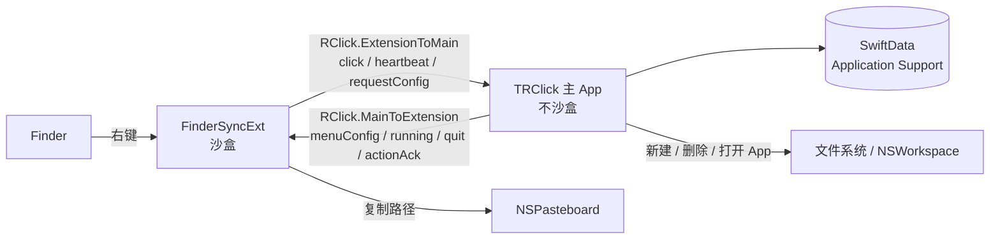

# TRClick 个人自用改造方案

> 状态：**分析稿，未改动任何代码**
> 日期：2026-11-11
> 仓库：`RClick`（上游 [wflixu/RClick](https://github.com/wflixu/RClick)）
> 目标机器：macOS 27.2.1 (26B131)，Apple Silicon

---

## 0. TL;DR

- 需要的 5 个功能 RClick **全部已有**，不需要从零写；需要改的是**架构**，不是功能。
- 自用**不需要付费开发者账号**，但前提是：**去掉 App Group + 主 App 去掉沙盒**。
  保留 App Group 就必须有 Team ID（macOS 26+ 的硬约束），这才是"要账号"的真正原因。
- 改造后架构：主 App（不沙盒）负责配置、文件操作、自动更新；Finder 扩展（**必须沙盒**）只负责画菜单、发事件、复制路径。
- CI 需要产出 **`.app.zip`（给自动更新）+ `.dmg`（给手动安装）**，并且 Release 不能标记为 prerelease。
- 工作量约 **1–2 天**，其中最关键、也最需要实测的一步是：**ad-hoc 签名的 Finder 扩展能否被系统加载**。

---

## 1. 背景

### 1.1 目标

| # | 需求 | 说明 |
|---|---|---|
| 1 | 右键新建常见文本文件 | txt / json / md 等，最好可自行增删类型 |
| 2 | 右键复制绝对路径 | 支持多选 |
| 3 | 右键用指定 App 打开 | App 列表可手动添加 |
| 4 | 右键彻底删除 | 不走废纸篓 |
| 5 | GitHub Actions 打 DMG + 动态更新 | 自用、不分发 |
| 6 | 软件改名 | TRClick |

### 1.2 本机环境实测

| 项 | 值 |
|---|---|
| macOS | 27.2.1 (Build 26B131) |
| 签名身份 | `security find-identity -v -p codesigning` → **0 valid identities** |
| Xcode | `xcode-select -p` → `/Library/Developer/CommandLineTools`（**未安装完整 Xcode**） |
| 已安装 Xcode 版本 | 无（`xcodebuild -version` 无输出） |

> 结论：目前只能 ad-hoc 签名；要本地构建/调试必须先装 Xcode 26+。

### 1.3 非目标

- 不上架 App Store、不做公证（notarization）、不做 Developer ID 分发。
- 不需要 Windows 支持 —— 仓库本来就只有 macOS 代码，没有需要删除的 Windows 部分。
- 不追求通用性，只求本机可用、可维护。

---

## 2. 关键结论：为什么现在"必须要有账号"

### 2.1 两个硬约束

**约束一：App Group 需要 Team ID（macOS 26 起）**

- 无 Team ID 的 ad-hoc 签名访问 group container 会被 `containermanagerd` 拒绝：
  `Group containers identifiers should be prefixed by requestor's team ID ...`
- macOS 27 进一步收紧了跨团队容器访问（默认拒绝，不再弹授权框）。
- 此外，macOS 上 `containerURL(forSecurityApplicationGroupIdentifier:)` **即使没有 entitlement 也会返回一个格式正确的 URL**（iOS 才返回 nil），所以失败往往不是"拿不到路径"，而是之后建库时 SQLite `EPERM`。仓库里 `StartupFailure.swift` / `ModelContainer.swift` 的注释描述的就是这个场景。

**约束二：Finder 扩展必须沙盒**

- `pkd` 日志：`rejecting; ... plug-ins must be sandboxed`（见上游 issue #124）。
- 所以扩展不能靠"去掉沙盒"来绕过限制；能去掉沙盒的只有主 App。

### 2.2 证据来源

| 结论 | 来源 |
|---|---|
| macOS 26 起 ad-hoc 签名的 App Group 被拒 | [flux-markdown #13](https://github.com/xykong/flux-markdown/issues/13) |
| macOS 27 上签名缺 application/team identifier 导致建库 EPERM、启动即退 | [RClick PR #141](https://github.com/wflixu/RClick/pull/141) |
| `group.` 前缀的 App Group 必须进 provisioning profile；`<TeamID>.` 前缀不需要 profile、不需要门户注册 | [Apple 文档](https://developer.apple.com/documentation/xcode/accessing-app-group-containers) |
| Finder 扩展必须沙盒 | [RClick issue #124](https://github.com/wflixu/RClick/issues/124) |
| macOS 15+ 取消"右键 → 打开"绕过 Gatekeeper | [参考提交](https://github.com/amd/gaia/commit/24e7584b569d8f7eccbd2422818425d10b687b3e) |

### 2.3 三条路线对比

| 路线 | App Group | 需要什么 | 代码改动 | 可靠度 |
|---|---|---|---|---|
| **A. 去 App Group + 主 App 去沙盒**（推荐） | 不用 | 只要 ad-hoc 签名 | 中（6–9 个文件） | 高，唯一不确定点是扩展能否加载 |
| B. 保留 App Group + 免费 Apple ID（Personal Team） | `<TeamID>.RClick`（无 `group.` 前缀） | 一个免费 Apple ID | 小（只改 entitlements + 常量） | 中，Xcode 自动签名可能拒绝该组合 |
| C. 保留 App Group + 付费账号 | `group.<bundle-id>` | $99/年 + 两份 provisioning profile | 小 | 高，但与"不折腾账号"冲突 |

**推荐 A**：它把"账号"这个前提彻底移除，代价是改造存储和权限两层（这两层本来也是 RClick 里最"重"的部分）。

---

## 3. 目标架构

### 3.1 进程职责

| 进程 | 沙盒 | 职责 | 存储 |
|---|---|---|---|
| 主 App `TRClick.app` | **否** | 菜单栏常驻；持有配置；执行新建/删除/打开 App；检查更新并自替换 | `~/Library/Application Support/TRClick/TRClickDatabase.sqlite` + `UserDefaults.standard` |
| Finder 扩展 `FinderSyncExt.appex` | **是**（系统强制） | 画右键菜单；发送点击事件；复制路径快链路；心跳/离线提示 | 无（纯内存） |

### 3.2 数据流



**关键点**：扩展不读 SwiftData、不读 UserDefaults、不写文件。现在唯一例外是 `Shared/HintClickLaunch.swift` 的标记文件，可直接去掉（见 §5.D）。

### 3.3 存储位置

| 数据 | 现状 | 目标 |
|---|---|---|
| SwiftData 库 | `~/Library/Group Containers/group.cn.wflixu.RClick/TRClickDatabase.sqlite` | `~/Library/Application Support/TRClick/TRClickDatabase.sqlite` |
| UserDefaults | `UserDefaults(suiteName: "group.cn.wflixu.RClick")` | `UserDefaults.standard` |
| 启动标记 | App Group 容器内 `hintClickLaunchAt` | 删除（保留 `RC_QUIET_LAUNCH` 环境变量） |
| 文件夹授权 | security-scoped bookmark（BookmarkEntity） | 不再需要（不沙盒后直接访问） |

> 换存储 = **换库**：首次启动是空库，会自动写入默认动作/文件类型/App 预设，旧配置不会带过来。

### 3.4 保留 / 删除对照

| 模块 | 处理 |
|---|---|
| Finder 扩展的菜单渲染、IPC、心跳、离线提示 | **原样保留** |
| 动作执行（新建/删除/打开） | **保留**，去掉授权环节 |
| SwiftData 模型与 ConfigService | **保留**，只换路径 |
| BookmarkManager / PermissionService | **降级为直通**（代码可留，逻辑不再拦截） |
| 常用目录（CommonDir）、AirDrop、Hide/Unhide | 默认关闭，可后续删除 |
| 文件夹权限设置页、完全磁盘访问探测 | **隐藏**，避免 TCC 探测弹窗 |
| 自动更新 | **保留**，改指向自己的仓库，并让 CI 产出 `.app.zip` |
| 多语言 | 保留（改名时按需替换品牌词） |

---

## 4. 功能映射

| 需求 | 现有实现 | 现状 | 改造点 |
|---|---|---|---|
| 1. 新建 txt/json/md 等 | `NewFile` / `NewFileTypeEntity`、`ActionService.createFile()` | 可用；默认 9 种类型，**JSON 默认关闭** | 去沙盒后权限直通；把 json 默认打开；模板机制保留 |
| 2. 复制绝对路径 | `copy-path`，扩展内快链路 `copyPathsLocally()` | **完全满足**，主 App 未运行也能用 | 无 |
| 3. 打开指定 App | `AppEntity` + `AppsSettingsTabView` + `ActionService.openApp()` | 可用 | 不再弹 NSOpenPanel 授权 |
| 4. 彻底删除 | `delete-direct` → `FileManager.removeItem`（**不是废纸篓**） | 可用；有受保护目录检查 + 确认框，按住 Option 跳过确认 | 去掉 bookmark 授权环节 |
| 5. DMG + 动态更新 | `Updater.swift`：查 `/releases/latest` → 取 `.app.zip` → 替换 `/Applications` → 重启 | 机制在，但当前 CI 不产 zip，且发布为 prerelease | 见 §5.E / §5.F |

**第 5 点的三个硬约束**：

1. 更新器只认文件名以 `.app.zip` 结尾的资产（`Updater.swift:335`），DMG 它不看。**DMG 给人装，zip 给更新器用，两个都要产。**
2. `/releases/latest` 不返回 draft / prerelease。当前 `release.yml` 里 `prerelease: true` 必须改成 `false`。
3. 更新器替换的是 `/Applications/<CFBundleName>.app`。`PRODUCT_NAME = TRClick` 后 `CFBundleName` 自动变 TRClick，路径才匹配。

---

## 5. 改动清单

> 行号基于当前代码，后续改动会让行号漂移，请以符号名为准。

### A. 签名与工程配置

| 文件 | 现状 | 改法 | 影响 |
|---|---|---|---|
| `TRClick/TRClick.entitlements`、`TRClick/TRClickDebug.entitlements` | 含 `app-sandbox`、`application-groups`、`files.bookmarks.app-scope`、`files.user-selected.read-write`、`network.client` | 删除 sandbox 和 group 相关项（主 App 不再沙盒） | 主 App 可直接读写文件；不再需要 profile |
| `FinderSyncExt/FinderSyncExt.entitlements:9` | 含 `application-groups` | **只删** `application-groups`，保留 `app-sandbox` | 扩展仍可被 `pkd` 加载 |
| `project.pbxproj` | 主 App 两处 `ENABLE_APP_SANDBOX = YES` | 改成 `NO`（扩展保持 YES） | 构建产物的沙盒状态 |
| `project.pbxproj` | `REGISTER_APP_GROUPS = YES` ×4（行 511/549/628/663） | 删除 | 不再尝试去开发者门户注册 |
| `project.pbxproj` | `DEVELOPMENT_TEAM = 4L3563XCBN` ×8（行 394/461/494/532/566/588/611/646） | 清空 | 否则会报找不到签名证书 |
| `project.pbxproj` | Bundle ID `cn.wflixu.RClick` 等 | 见 §5.G | 与旧版隔离 |
| CI | `CODE_SIGNING_ALLOWED=NO` | 见 §5.F：必须补 ad-hoc `codesign`，否则扩展没有 sandbox entitlement | DMG 是否可用 |

### B. 存储层

| 文件 | 现状 | 改法 |
|---|---|---|
| `TRClick/Model/ModelContainer.swift:91-94` | `containerURL(forSecurityApplicationGroupIdentifier:)` + `TRClickDatabase.sqlite` | 改为 `applicationSupportDirectory` + `TRClick/` 子目录；**需自行 `createDirectory`**；`SharedStoreError.appGroupUnavailable` 分支可删 |
| `TRClick/Shared/StringExtension.swift:97-103` | `UserDefaults(suiteName: "group.cn.wflixu.RClick")` | 直接 `static let group: UserDefaults = .standard`，**一处改动覆盖所有 `@AppStorage(store: .group)`** |
| `TRClick/Shared/Constants.swift:28` | `suitName = SharedAppGroup.identifier` | 随 `SharedAppGroup` 一起删除或废弃 |
| `Shared/HintClickLaunch.swift` | 依赖 App Group 容器 | 删除标记逻辑（见 D） |
| `TRClick/Shared/StartupFailure.swift` | 兜底启动失败提示 | 保留，文案里的 "App Group" 可改 |

### C. 权限层

去沙盒后，bookmark 永远 `hasAccess == false`，会**每次操作都弹 NSOpenPanel**，必须直通：

| 文件 | 改法 |
|---|---|
| `TRClick/Runtime/PermissionService.swift` | `hasAccess(to:)` → `return true`；`promptForPermission(for:)` → `return url`。调用点（`ActionService` 多处）无需改动 |
| `TRClick/AppState.swift:29` | `BookmarkManager()` 可保留（不再被用到），后续再删 |
| `TRClick/Settings/FolderPermissionsSheetView.swift` | 从设置页移除入口 |
| `TRClick/Settings/GeneralSettingsTabView.swift:228-244` | 隐藏「完全磁盘访问 / 辅助功能」探测，避免打开设置就触发 TCC 探测 |

### D. 扩展与主 App 边界

| 文件 | 改法 |
|---|---|
| `FinderSyncExt/FinderSyncExt.swift` | 菜单、IPC、心跳、离线提示**不用改** |
| 同上 `:563` `handleLaunchHostClick` | 删除 `HintClickLaunch.mark()` 调用，保留 `RC_QUIET_LAUNCH` 环境变量。副作用：主 App 已在运行时点离线提示，可能顺带弹出设置窗口 |
| `Shared/Messager.swift:263-264` | 建议把通知名改成 `TRClick.*`，避免与旧版 RClick 互相收消息（`MessageSecurity.swift:26` 的 HMAC 密钥也建议换掉） |
| `TRClick/TRClick.entitlements` 等 | 不再声明 App Group，扩展只靠 IPC 取配置 |

> 扩展本来就没有磁盘缓存（`cachedMenuConfig` 只在内存），所以去掉 App Group 后**不需要新的共享存储**。

### E. 更新器

| 文件 | 改法 |
|---|---|
| `TRClick/TRClickApp.swift:37`、`TRClick/Settings/AboutSettingsTabView.swift:255` | `owner/repo` 改成自己的 GitHub 仓库 |
| `TRClick/Shared/Updater.swift:335` | 不用改；但 CI 必须产出 `*.app.zip` |
| `TRClick/Shared/Updater.swift:496` | 替换前把旧 App 移到废纸篓；不沙盒后可用（沙盒下会被拒） |
| 可选 | 增加 SHA256 校验（当前完全不校验下载内容） |
| 安装位置 | 必须装在 `/Applications`，否则「重启新版本」找不到 `CFBundleName.app` |

### F. CI

> 与上一轮"只保留编译 + create-dmg"的结论有冲突：**要产出能用的 DMG，就必须有签名（哪怕是 ad-hoc）**。请二选一。

**形态一：只做编译验证（上一轮的清理版）**

- `CODE_SIGNING_ALLOWED=NO` + create-dmg + artifact。
- 产物**不可用**：扩展没有 sandbox entitlement 会被拒载，主 App 也读不到 App Group。

**形态二：产出可用 DMG（推荐）**

1. `xcodebuild ... CODE_SIGNING_ALLOWED=NO`；
2. 补 ad-hoc 签名（不需要任何证书/secret）：
   ```bash
   codesign --force --sign - \
     --entitlements FinderSyncExt/FinderSyncExt.entitlements \
     "$APP_PATH/Contents/PlugIns/FinderSyncExt.appex"
   codesign --force --sign - "$APP_PATH"
   codesign --verify --strict --verbose=2 "$APP_PATH/Contents/PlugIns/FinderSyncExt.appex"
   ```
   注意：先签内层 `.appex`，再签外层 `.app`；ad-hoc 签名不能加 `--timestamp`。
3. 产 `TRClick-vX.dmg`（手动安装）和 `TRClick-vX.app.zip`（自动更新；zip 根目录就是 `TRClick.app`）；
4. 发布 Release：**`prerelease: false`**，否则更新器查不到；资产至少包含 `.app.zip`；
5. 可选：附 `.sha256`。

### G. 改名 TRClick

建议**分两步**，别一次全改。

**第一步（低风险，够用）**

| 位置 | 改法 |
|---|---|
| `project.pbxproj` 主 App `PRODUCT_NAME` | `TRClick` |
| `project.pbxproj` 主 App `PRODUCT_MODULE_NAME` | 显式设 `RClick`（否则测试里的 `@testable import RClick` 全废） |
| `INFOPLIST_KEY_CFBundleDisplayName` | `TRClick`（主 App 和扩展都改） |
| `FinderSyncExt/FinderSyncExt.swift:321,425` | `toolbarItemName` / `NSMenu(title:)` 改 `TRClick` |
| Bundle ID | `com.tfcup.TRClick`、`com.tfcup.TRClick.FinderSyncExt`（扩展必须以主 App ID + `.` 开头） |
| `release.yml` | `APP_NAME: TRClick` |
| 更新器 | repo 指向你的仓库 |

**第二步（可选，只影响整洁度）**

- 改 target 名 / `TRClick.xcodeproj` 文件名 / scheme 名：会连带 scheme 的 `BuildableName`、10 个测试文件的 `import`、`TRClickTests` target，diff 很大但纯机械。

**品牌字符串**

- `TRClick/Localizable.xcstrings` 84 处、`FinderSyncExt/Localizable.xcstrings` 42 处。
- 其中一部分是代码里 `AppLocalization.localized("RClick ...")` 的 **key**：只改 catalog 不改代码会导致查不到（回退成 key 本身）。要么只改 en/zh-Hans 的 value（key 不动），要么 key + 代码一起全局替换。

**别忘了**

- 卸载/退出官方 RClick，否则两个进程监听同一通知名会串消息。

### H. 精简（可选）

| 项 | 处理 |
|---|---|
| 常用目录（CommonDir） | 设置页移除或保留（默认不显示） |
| AirDrop / Hide / Unhide | 默认就是关闭的，可直接删代码或保持关闭 |
| 26 个 App 预设 | 保留（对"打开方式"有用） |
| 5 种语言 | 保留，改名时再处理 |
| 权限页 | 移除 |

---

## 6. 实施阶段

| 阶段 | 内容 | 验收标准 |
|---|---|---|
| 0 | 安装 Xcode 26+，`sudo xcode-select -s /Applications/Xcode.app/Contents/Developer` | `xcodebuild -version` 有输出 |
| 1 | 去沙盒 + 去 App Group + 存储搬家 + 权限直通 | 本机右键菜单出现；新建/删除/打开 App/复制路径 4 项全通；启动不报数据库错误 |
| 2 | 改名 TRClick（第一步） | DMG 里是 `TRClick.app`，菜单标题是 TRClick |
| 3 | CI：ad-hoc 签名 + dmg + app.zip + 非 prerelease Release | 从 Actions 下载 DMG，`xattr -cr` 后能装、扩展能启用 |
| 4 | 更新器指向自己的仓库 | 发一个更高版本，App 内「检查更新」能下载并替换、重启 |
| 5 | 精简设置页/功能 | 按需 |

> **先做阶段 1**：它是"不要账号"这个前提能否成立的唯一验证点。

---

## 7. 风险与待验证

| # | 风险 | 影响 | 验证方式 | 回退 |
|---|---|---|---|---|
| 1 | ad-hoc 签名的 Finder 扩展能否被 `pkd` 加载 | 整个方案成立与否 | 阶段 1 跑一次；`pluginkit -m -i com.tfcup.TRClick.FinderSyncExt` | 免费 Personal Team（`<TeamID>.` 组）或付费账号 |
| 2 | `SMAppService.mainApp.register()` 在 ad-hoc 下是否成功 | 开机自启失效 → 扩展显示"未运行" | 设置里打开自启后看「系统设置 → 通用 → 登录项」 | 手动添加登录项 |
| 3 | 每次更新后 TCC 是否重新弹窗 | 桌面/文稿/下载目录要重新授权 | 连续更新两次观察 | 接受，或让 App 装在非 TCC 目录 |
| 4 | 更新后 Finder 是否加载新扩展 | 菜单行为可能还是旧版 | 更新后看扩展版本/行为 | 更新后 `killall Finder` |
| 5 | `/Applications` 可写性 | 更新器可能要求授权目录 | 在 `/Applications` 上试一次更新 | 用 NSOpenPanel 授权 |

> 说明：第 1 条是最关键的未知项。Xcode 本地开发（DerivedData + "Sign to Run Locally"）通常可以加载扩展，但从 DMG 安装到 `/Applications` 后是否一致，必须在你的机器上实测一次。

---

## 8. 工作量估算

| 部分 | 估算 |
|---|---|
| 装 Xcode + 首次跑通 | 半天（主要是下载） |
| 阶段 1（去沙盒 / 去 App Group） | 2–4 小时 |
| 阶段 2（改名，第一步） | 1–2 小时 |
| 阶段 3（CI 签名 + 打包 + Release） | 1–2 小时 |
| 阶段 4（更新链路） | 1 小时 |
| 风险点 1–5 验证 | 半天 |
| **合计** | **约 1–2 天** |

---

## 9. 附录（示意代码，未实施）

### A. entitlements 目标形态

`FinderSyncExt/FinderSyncExt.entitlements`：

```xml
<?xml version="1.0" encoding="UTF-8"?>
<!DOCTYPE plist PUBLIC "-//Apple//DTD PLIST 1.0//EN" "http://www.apple.com/DTDs/PropertyList-1.0.dtd">
<plist version="1.0">
<dict>
    <key>com.apple.security.app-sandbox</key>
    <true/>
</dict>
</plist>
```

主 App：不再需要沙盒和 App Group 相关键（可直接删除 `CODE_SIGN_ENTITLEMENTS` 或保留空 dict）。

### B. ModelContainer 路径（示意）

```swift
let baseURL = try FileManager.default.url(
    for: .applicationSupportDirectory,
    in: .userDomainMask,
    appropriateFor: nil,
    create: true
)
let directory = baseURL.appendingPathComponent("TRClick", isDirectory: true)
try FileManager.default.createDirectory(at: directory, withIntermediateDirectories: true)

let storeURL = directory.appendingPathComponent("TRClickDatabase.sqlite")
let configuration = ModelConfiguration(url: storeURL, allowsSave: true, cloudKitDatabase: .none)
```

### C. CI ad-hoc 签名 + 打包（示意）

```bash
# 1) 先签内层 appex（带 sandbox entitlement）
codesign --force --sign - \
  --entitlements FinderSyncExt/FinderSyncExt.entitlements \
  "$APP_PATH/Contents/PlugIns/FinderSyncExt.appex"

# 2) 再签外层 app
codesign --force --sign - "$APP_PATH"

# 3) 校验
codesign --verify --strict --verbose=2 "$APP_PATH/Contents/PlugIns/FinderSyncExt.appex"

# 4) 给更新器用的 zip（根目录必须是 TRClick.app）
ditto -c -k --sequesterRsrc --keepParent "$APP_PATH" "TRClick-v${VERSION}.app.zip"
```

### D. 参考链接

- [Apple：Accessing app group containers](https://developer.apple.com/documentation/xcode/accessing-app-group-containers)
- [RClick PR #141：macOS 27 App Group 签名问题](https://github.com/wflixu/RClick/pull/141)
- [RClick issue #124：扩展必须沙盒](https://github.com/wflixu/RClick/issues/124)
- [flux-markdown #13：macOS 26 ad-hoc App Group 被拒](https://github.com/xykong/flux-markdown/issues/13)
- [Gatekeeper：macOS 15 Sequoia 的 Open Anyway 流程](https://github.com/amd/gaia/commit/24e7584b569d8f7eccbd2422818425d10b687b3e)

---

## 10. 已定决策

1. 路线 A：去 App Group + 主 App 去沙盒。
2. CI 产出可用 DMG：ad-hoc 签名 + `.app.zip` + DMG + 非 prerelease Release。
3. 改名只做“第一步”：product name / 显示名 / Bundle ID / 菜单标题；target、project、scheme 名称保持不变。

## 11. 变更记录

| 日期 | 内容 |
|---|---|
| 2026-11-11 | 初稿：基于仓库实际代码与本机环境实测结果整理，未改动代码 |
| 2026-11-11 | 阶段 1 + 阶段 2（改名第一步）+ 阶段 3（CI）落地；未做真机编译 |

## 12. 实施进展

### 已完成 — 2026-11-11

**架构**

- **entitlements**：主 App（`TRClick.entitlements` / `TRClickDebug.entitlements`）移除 `app-sandbox` 与 `application-groups`；扩展只移除 `application-groups`，保留 `app-sandbox`。
- **project.pbxproj**：主 App 两处 `ENABLE_APP_SANDBOX = NO`；删除 8 处 `DEVELOPMENT_TEAM`、4 处 `REGISTER_APP_GROUPS`。
- **存储**：`SharedDataManager` 改为 `~/Library/Application Support/TRClick/TRClickDatabase.sqlite`；`UserDefaults.group` 改为 `.standard`。
- **权限**：`PermissionService` 改为直通（`hasAccess` 恒 true、`promptForPermission` 直接返回原路径）。
- **启动标记**：删除 `Shared/HintClickLaunch.swift`（含 `SharedAppGroup`），清理调用点与 `Constants.suitName`。
- **IPC**：通知名改为 `TRClick.MainToExtension` / `TRClick.ExtensionToMain`。
- **默认值**：新建文件类型 JSON 默认启用。

**改名（彻底）**

- 工程：`RClick.xcodeproj` → `TRClick.xcodeproj`；target `RClick` / `RClickTests` → `TRClick` / `TRClickTests`；scheme `RClick` → `TRClick`。
- 目录：`RClick/` → `TRClick/`、`RClickTests/` → `TRClickTests/`；入口 `RClickApp.swift` → `TRClickApp.swift`；entitlements 文件改名。
- 模块名：`PRODUCT_MODULE_NAME = TRClick`，测试改为 `@testable import TRClick`。
- 标识：Bundle ID `com.tfcup.TRClick` / `com.tfcup.TRClick.FinderSyncExt` / `com.tfcup.TRClickTests`。
- 运行时字符串：数据库文件、HMAC key、备份文件名、日志 subsystem 全部同步。
- 界面：`CFBundleDisplayName`、Finder 菜单/工具栏标题、设置页标题、两套 `.xcstrings` 品牌词、导出文件名、模板目录。

**核心功能精简（只保留新建文件 / 复制路径 / 打开 App / 彻底删除 / 自动更新）**

- **删除 AirDrop / Hide / Unhide**：`RCAction` 定义与默认项、`displayName` 分支、`ActionService` 的 `showAirDrop` / `hideFilesAndDirs` / `unhideFilesAndDirs` 与分发分支。
- **删除 CommonDirs**：`CommonDirEntity`、`CommonDir` / `CommonDirMenuItem`、`MenuConfigPayload` 字段、`AppState.cdirs` / `showCommonDirs` / `foldCommonDirMenu`、`ConfigService` 读写、`MenuService`、设置页 tab 与 `CommonDirsSettingTabView`、`ActionService.openCommonDirs`、扩展菜单与点击处理、数据迁移与设置备份、`iconForDirectory`。
- **删除 Bookmark 体系**：`BookmarkManager`、`BookmarkEntity`、`PermissionService` 的依赖、`AppState` 的恢复逻辑、`SettingsBackup` 相关字段；`SharedStoreError.appGroupUnavailable` 与 `looksLikeAuthorizationDenial` 一并删除。
- **删除文件**：`TRClick/Info.plist`（未被构建引用，Info.plist 由 Xcode 生成）。
- **删除文档**：`CODE_OF_CONDUCT.md`、`CONTRIBUTING.md`、`SECURITY.md`、旧 `specs/*.md`；保留 `README.md`、`CHANGELOG.md`、`LICENSE` 和本方案。
- **测试同步**：`BookmarkAccessTests` 删除；其余测试去除 CommonDirs/Bookmark 依赖与 6 个动作的假设。

**更新与 CI**

- 更新器 `owner/repo` = `tfcup/TRClick`。
- `release.yml` 重写为 ad-hoc 签名（内层 appex 带 sandbox、外层 app 不带）+ 签名校验 + `.app.zip` + DMG + sha256 + **非 prerelease** Release + artifact。

发布方式：`git tag v0.1.0 && git push origin v0.1.0`，Actions 产出 Release（zip 给更新器、dmg 给手动安装）。

校验：`plutil -lint` 通过；全部 Swift 文件 `swiftc -parse` 通过；两套 `.xcstrings` 合法且 `check-localization.py --languages es fr ja zh-Hans` 通过；两个 workflow YAML 解析通过；**未做完整编译**（本机未安装 Xcode）。

### 待验证 / 未做

- 真机编译与运行（本机未装 Xcode）。
- **关键实测点**：ad-hoc 签名的 Finder 扩展能否被 `pkd` 加载（`pluginkit -m -i com.tfcup.TRClick.FinderSyncExt`）。
- 首次从 DMG 安装后需要 `xattr -cr /Applications/TRClick.app` 去掉 quarantine。
- **SwiftData schema 已变化**：若之前跑过旧版本，请删除 `~/Library/Application Support/TRClick/` 后再启动；旧库中的 hide/unhide/airdrop 动作行不会被自动清理，会在设置页出现但点击无动作。
